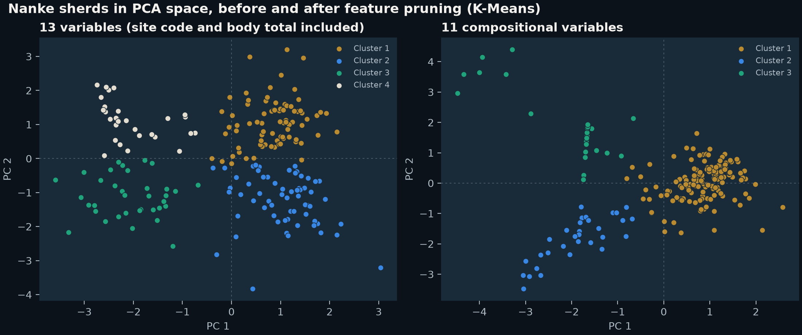
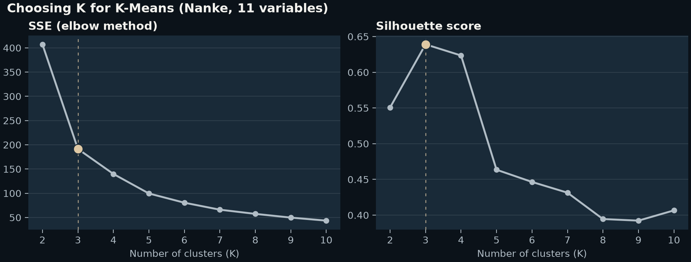
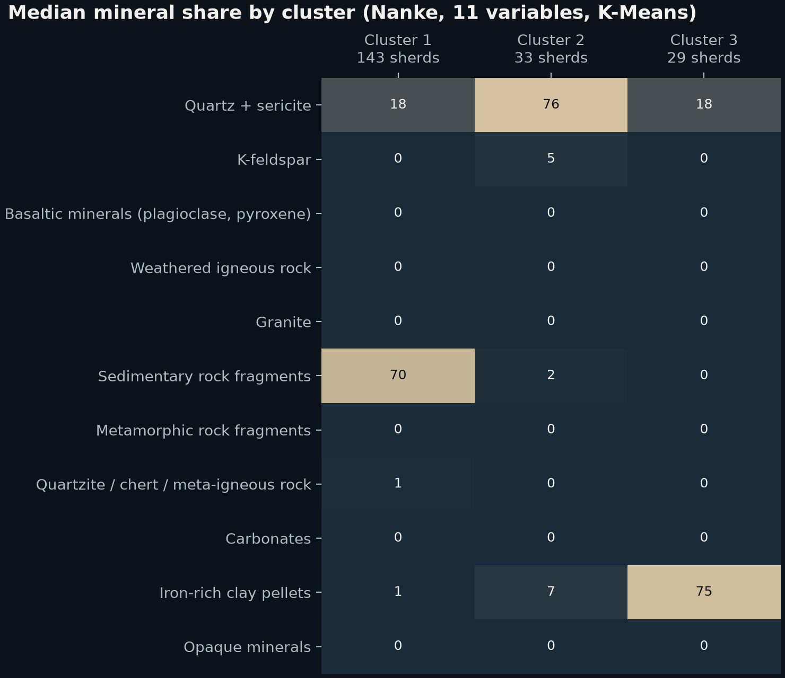

# Archaeological Ceramic Clustering: Penghu & Nanke

Unsupervised clustering of 257 pottery sherds from 28 excavation sites by mineral composition, during my data science internship at Academia Sinica with the Institute of History and Philology.

## Context

Academia Sinica is Taiwan's premier research institute. During my data science internship at its Institute of Statistical Science, I worked across disciplines with archaeologists from the Institute of History and Philology on one question: where might Penghu's early inhabitants have come from?

The minerals and rock fragments in pottery clay record where its raw materials came from, so sherds with similar compositions likely share a source. The data covers 257 sherds from 28 excavation sites: 52 from 11 sites in Penghu and 205 from 17 sites in Nanke (excavation sites in the Southern Taiwan Science Park, Tainan), each recorded as the proportions of its mineral and rock components.

There is no ground truth: no one knows which group a sherd "should" belong to. The structure has to come from the data itself, so the analysis uses unsupervised learning.

## Data

Each sherd is described by 11 compositional variables:

Quartz + sericite · K-feldspar · Basaltic minerals (plagioclase, pyroxene) · Weathered igneous rock · Granite · Sedimentary rock fragments · Metamorphic rock fragments · Quartzite / chert / meta-igneous rock · Carbonates · Iron-rich clay pellets · Opaque minerals

**The data is not included.** It belongs to the research institutions and is not public. [`data/README.md`](data/README.md) documents the expected columns, types and preprocessing, so the pipeline can run on a copy of the tables.

## Method

1. **Leak-proof feature engineering (14 → 13 → 11 variables).** Dropping the non-numeric ID fields and encoding the site as a number leaves 13 variables. But the site code hands the model the answer: clusters would follow where a sherd was excavated rather than what it is made of, and coding site categories as integers creates distances that don't exist. The body total describes texture, the ratio of clay matrix to grains, rather than which minerals the grains are. Removing both leaves 11 purely compositional variables. Every experiment runs on both the 13- and 11-variable sets to test that choice.
2. **Correlation analysis.** Before modeling, a correlation heatmap shows how the mineral variables relate to each other.
3. **PCA.** The standardized variables are projected onto their first two principal components. Both clustering methods run in this 2D space, so the groups can be seen directly.
4. **K-Means.** K is chosen with the elbow method (SSE) together with silhouette analysis; when the elbow is unclear, the silhouette score decides.
5. **DBSCAN.** A density-based method that needs no preset number of clusters and flags isolated sherds as noise. `eps` and `min_samples` are chosen by a silhouette-based grid search.
6. **Build on Penghu, then transfer.** The workflow was developed on the Penghu data, then applied to the Nanke data, roughly four times larger, using the same steps with K and the DBSCAN parameters re-tuned for each dataset.
7. **Evaluation.** Silhouette scores (below 0 poor, 0 to 0.5 fair, above 0.5 strong structure), and each cluster's mineral signature: boxplots in the original analysis, a median table here. For DBSCAN, noise points are treated as their own group when computing the silhouette, as in the original analysis.

All parameters (K, `eps` and `min_samples` grids, `n_init`, `random_state`) are in [`src/config.py`](src/config.py).

## Results

Silhouette score, 13 → 11 variables:

| Region | K-Means | DBSCAN |
|---|---|---|
| Penghu | 0.48 → **0.57** | 0.40 → **0.49** |
| Nanke | 0.50 → **0.64** | 0.46 → **0.58** |

- Feature engineering improved separation in all four comparisons — both methods, both regions.
- Best model: K-Means on 11 compositional variables reached 0.64 on Nanke, in the "strong structure" range (above 0.5).
- K-Means beat DBSCAN on every dataset, evidence that the compositional groups are compact and well-defined rather than artifacts of noise; DBSCAN added value by flagging isolated sherds for re-examination.

The pipeline reproduces these scores within 0.02; its exact output, with the chosen parameters and group counts, is in [`results/silhouette.csv`](results/silhouette.csv).







More figures in [`results/figures/`](results/figures): every clustering side by side, the DBSCAN parameter grid, and the correlation heatmap.

## Reproduce

```bash
python -m venv .venv
source .venv/bin/activate
pip install -r requirements.txt

# Either place the tables at data/penghu.xlsx and data/nanke.xlsx, or point to them:
SINICA_PENGHU=/path/to/penghu.xlsx SINICA_NANKE=/path/to/nanke.xlsx python run_pipeline.py
```

The run writes `results/silhouette.csv` and `results/figures/`. Without the data it stops with `Data not included. See data/README.md.`

## Project history

Original analysis: Oct 2021 – Jan 2022 (Academia Sinica internship). Refactored into a reproducible pipeline in 2026.

## Portfolio

Case study: [paul-lai.vercel.app/projects/ceramic-clustering](https://paul-lai.vercel.app/projects/ceramic-clustering/)

## License

The code is released under the [MIT License](LICENSE). The license does not cover the sherd data.
